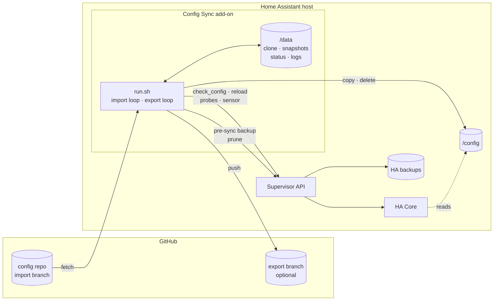
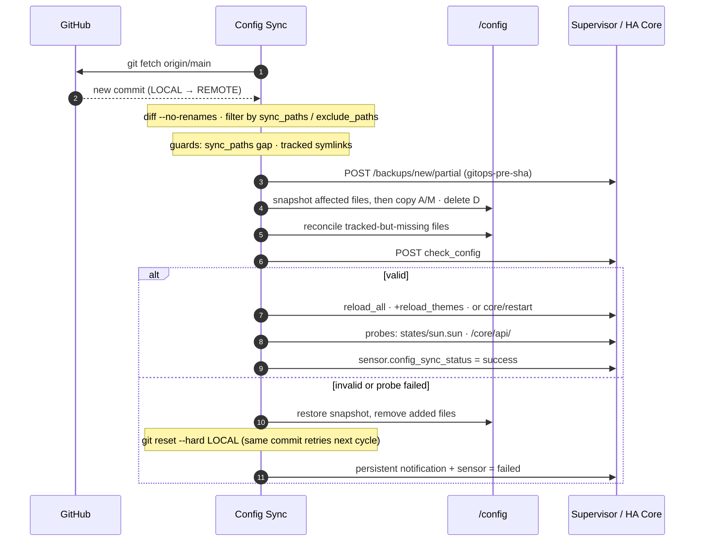

# Config Sync (GitOps) — Home Assistant add-on

GitOps for Home Assistant. A Git repository is the source of truth for
`/config`; the add-on pulls each new commit, validates it with Home
Assistant's own config checker, reloads (or restarts) the right amount,
verifies that HA is still healthy, and rolls back if anything fails.
Optionally it exports UI-made changes back to the repository.

No SSH, no Samba, no long-lived HA tokens: the add-on talks to Home
Assistant only through the Supervisor API, and to GitHub only over HTTPS.

- **Current version:** 1.7.2 — see [CHANGELOG](config-sync/CHANGELOG.md)
- **Platforms:** `amd64`, `aarch64` (Home Assistant OS or Supervised)
- **Full documentation:** [config-sync/DOCS.md](config-sync/DOCS.md)

## Architecture



Every import is a guarded pipeline. Each gate either passes or rolls the
previous one back; nothing is left half-applied.



## Quick start

1. **Settings → Add-ons → Add-on Store → ⋮ → Repositories**, add
   `https://github.com/JLay2026/ha-addon-config-sync`, then install
   **Config Sync (GitOps)**.
2. On the **Configuration** tab set `github_repo` to your config repo's
   HTTPS URL. For a private repo, or to enable export, add a
   [fine-grained PAT](config-sync/DOCS.md#github-personal-access-token)
   scoped to that one repo with *Contents: read and write*.
3. Review `sync_paths` (what is allowed to flow between repo and
   `/config`) and `exclude_paths` (what never does — secrets, caches).
4. **Start** the add-on and watch the log. The first cycle clones the
   repo; later cycles import only what changed.
5. Optional: put `sensor.config_sync_status` on a dashboard and wire an
   automation to its `failed` state (examples in DOCS).

## Safety model

| Layer | What it does |
|---|---|
| Allowlist | Only `sync_paths` minus `exclude_paths` ever move; `configuration.yaml` `!include_dir_*` targets outside the allowlist abort the sync |
| Repo trust | `github_repo` host must be in `allowed_repo_hosts`; tracked symlinks abort the sync |
| Pre-sync backup | Partial HA backup of `/config` + `.storage` before any file is touched, optionally encrypted, pruned to a retention count |
| Validation | HA's `check_config` must pass before any reload |
| Right-sized reload | `reload_all`; plus `frontend.reload_themes` for themes; a full core restart only when the `lovelace:` block changes |
| Verification | Post-reload probes of the state machine and REST API |
| Rollback | File-level snapshot restore (including removal of files the sync added) and git reset, so the next cycle retries the same commit |
| Observability | `sensor.config_sync_status`, a persistent notification on failure, per-sync structured logs under `/data/logs/` |

## Repository layout

```
config-sync/
  config.yaml      add-on manifest: options, schema, permissions, version
  build.yaml       HA base image per architecture
  Dockerfile       bash · git · curl · jq on the HA Alpine base
  run.sh           the whole add-on (import, export, guards, status, logs)
  DOCS.md          operator documentation (shown in the add-on's Documentation tab)
  CHANGELOG.md     release notes (shown in the add-on's update dialog)
repository.json    add-on repository manifest
.github/           CI (shellcheck + amd64 image build) and Dependabot
```

## Development

CI runs on every push and pull request: `shellcheck --exclude=SC1091,SC2012
config-sync/run.sh` and an amd64 `docker build` against the base image in
`build.yaml`. Run the same locally before opening a PR:

```sh
bash -n config-sync/run.sh
shellcheck --exclude=SC1091,SC2012 config-sync/run.sh
docker build --build-arg BUILD_FROM=ghcr.io/home-assistant/amd64-base:3.24 config-sync/
```

**Releasing.** Bump `version` in `config-sync/config.yaml`, add a section at
the top of `config-sync/CHANGELOG.md`, update `DOCS.md` if behaviour or
options changed, merge, then tag the merge commit
(`gh release create vX.Y.Z --target <full-sha> …`). Installed instances
pick the new version up on the Supervisor's next store refresh; the add-on
builds locally on the host from `build.yaml`.

**Dependencies.** Dependabot keeps the GitHub Actions current. The HA base
image pin in `build.yaml` is a build argument Dependabot cannot see; bump
it by hand when Alpine rolls
([home-assistant/docker-base releases](https://github.com/home-assistant/docker-base/releases)).

## License

MIT — see [LICENSE](LICENSE).
